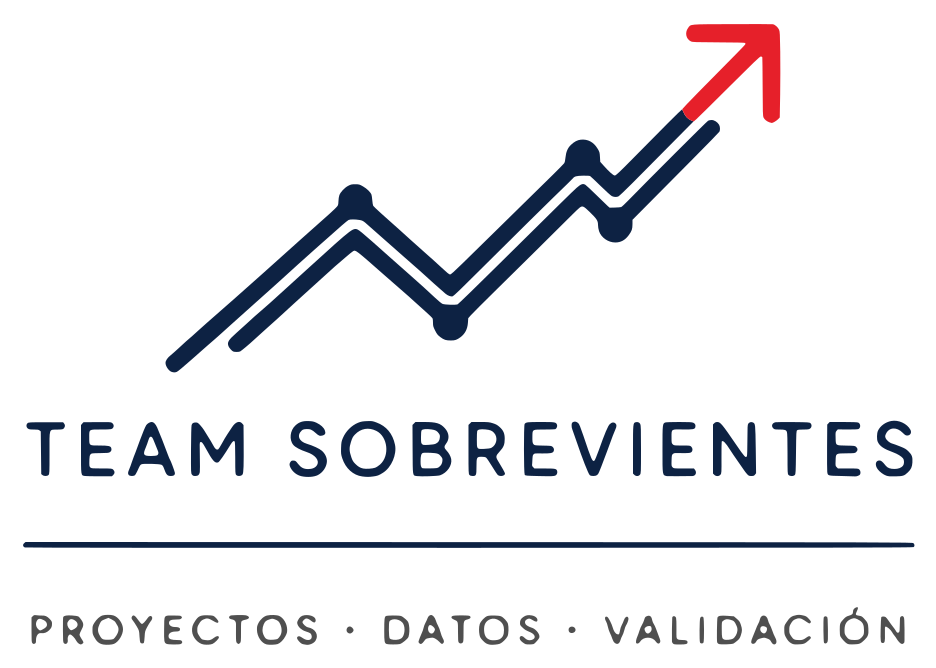

<p align="center">
  
</p>

# ProyectoTics — CasaScore (AlquilaPuno)

Repositorio del equipo **Team Sobrevivientes** para el curso Gestión de Proyectos TICS (EST315), UNA Puno, semestre 2026-II.

**CasaScore** ordena los cuartos en alquiler de Puno con un puntaje de 0 a 100, el **CASA SCORE**, según el precio, la cercanía al punto que elige el arrendatario, la seguridad, los servicios y el tipo de baño, y muestra siempre el desglose del puntaje. Para probar la web, sigue los pasos de [`src/web/README.md`](src/web/README.md).

- **Project Manager:** Clyde Neil Paricahua Pari (`xClaIDx`)
- **Analista de Planificación:** Ruth Karina Apaza Solis (`R-Karina-A-Solis`)
- **Especialista Técnico:** Eliseo Tarqui Ajahuana (`Eliseo-Tarqui`)
- **Gestora de Comunicación, Riesgos y Documentación:** Viviana Mary Quisbert Quispe (`Viviana-11`)
- **Asesor:** Ing. Renzo Apaza Cutipa
- **Tablero:** https://github.com/users/xClaIDx/projects/1

## Estructura

```
docs/
  assets/img/          logos del encabezado institucional
  latex/
    00_comun/          documentos del equipo (C1 a C7)
    casascore/         expediente de CasaScore (01 a 28)
    horus_sentinel/    expediente de Horus Sentinel (01 a 09 y 16), proyecto excluido
  guia_pm/             guía del Project Manager y guías de cada integrante
src/                   app móvil (Expo) y web (Vite + React), a cargo del Especialista Técnico
```

Cada documento vive en su carpeta `NN_nombre/` con su `.tex` y su `.pdf` compilado. Cada integrante sube sus propios documentos mediante Pull Request, en la fecha prevista de cada uno.

## Cómo compilar un documento

Con `pdflatex`, dos veces, desde la carpeta del documento:

```
pdflatex archivo.tex
pdflatex archivo.tex
```

## Forma de trabajo

1. Cada tarea es una tarjeta del tablero con un responsable.
2. Se trabaja en una rama: `feature/casascore-...`, `fix/casascore-...` o `docs/casascore-...`.
3. Commits con el formato `tipo(proyecto-módulo): descripción`.
4. Toda integración a `main` entra por Pull Request aprobado por otro integrante.
